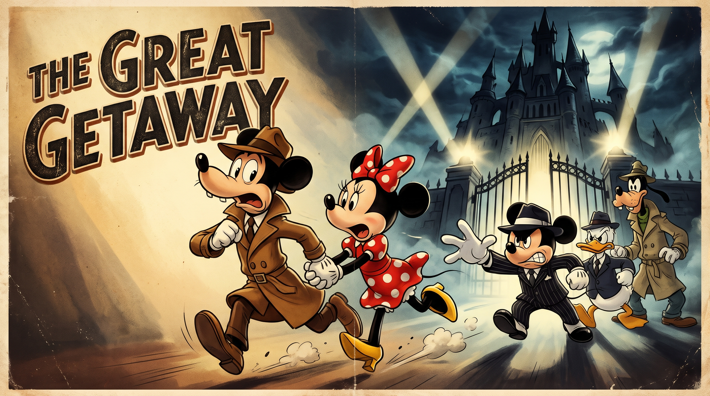

# The Great Getaway: Mickey’s Syndicate - The Toontown Trap
### A project made by Polojan Stefan-Alexandru, Borca Razvan-Andrei, Marin Iona-Alexaia
## 📖 Story & Game Structure

### Act 1: The Setup

Mortimer Mouse and Minnie are having dinner when Mafia Mickey and his Goofy-goons kick down the door. They kidnap Minnie and leave a ransom note from the "House of Mouse" syndicate. Mortimer grabs his trench coat and heads to Mickey’s towering Noir Castle.

### Act 2: The Courtyard

Mortimer arrives at the rain-slicked castle courtyard at night under a dark, stormy sky.

* **Task 1: The Guard Dog.** A monstrous Pluto guards the entrance. Mortimer sneaks behind a parked mafia car, searches the trunk, and finds a dart gun loaded with a sleeping dart. Aiming from the shadows, Mortimer fires the dart at Pluto, putting the guard dog to sleep so he can safely cross the courtyard.

* **Task 2: The Main Gates.** The keypad to the inner keep is dead. Mortimer navigates a small courtyard hedge maze, finds a heavy Cogwheel, and places it inside the backup generator to restore power and open the heavy doors to the keep.

### Act 3: The Syndicate Keep

Mortimer enters the dark lower halls of the castle, using a flashlight attached to his camera to light his path.

* **Task 3: The Pressure Plate & Weight Puzzle.** Mortimer reaches a heavy iron portcullis blocking the hallway. The mechanism is locked to a stone floor pressure plate that only opens the gate when weighted down. Mortimer must locate a heavy wooden crate in a side storage alcove, push/drag it onto the pressure plate to depress the floor tile, and lock the gate open before proceeding down the corridor.

* **Task 4: The Broken Elevator.** Mortimer reaches the Grand Elevator leading to the upper keep. However, the elevator controls are completely sabotaged. With the doors jammed, Mortimer pries open a narrow access panel and crawls out of the elevator cab directly into the castle's shadowy ventilation system.

### Act 4: The Twist & The Final Boss

Mortimer enters the lavish, gold-plated executive vault at the top of the tower. Mafia Mickey is there, quietly pouring tea. Sitting at the massive mahogany desk, stroking a white cat, is Minnie Mouse.

* **The Plot Twist:** Minnie orchestrated the kidnapping herself as "The Godmother" of the Toontown Underworld. Finding Mortimer too boring for her criminal empire, she hired Mickey to lure him to the castle to eliminate him and collect his life insurance.

* **The Boss Battle:** Minnie drops Mortimer into a lower arena with four fragile glass floor panels while operating a massive mechanical crane from a balcony above.

* **The Puzzle & Solution:** Mortimer dodges as Minnie drops massive steel safes, positioning himself so the falling safes shatter all four glass floor panels.

* **The Ending:** The shattered panels cause the structural pillars to collapse, sending Minnie’s balcony crashing into the castle moat. Mortimer lights a cigar, walks out of the crumbling castle, and the credits roll.
